# Inversiones Generales M & M — Alquileres


Web app para administrar los alquileres de **Inversiones Generales M & M
Inmobiliaria**: contratos, actualizaciones por índice, cobranza mes a mes y
liquidación a los propietarios. Pensada para Córdoba, Argentina: incluye el
**IPC de Córdoba** como índice de actualización, junto al ICL del BCRA, el IPC
nacional y el porcentaje fijo.

No hay servidor ni cuentas: los datos viven en el navegador y se respaldan en un
archivo.

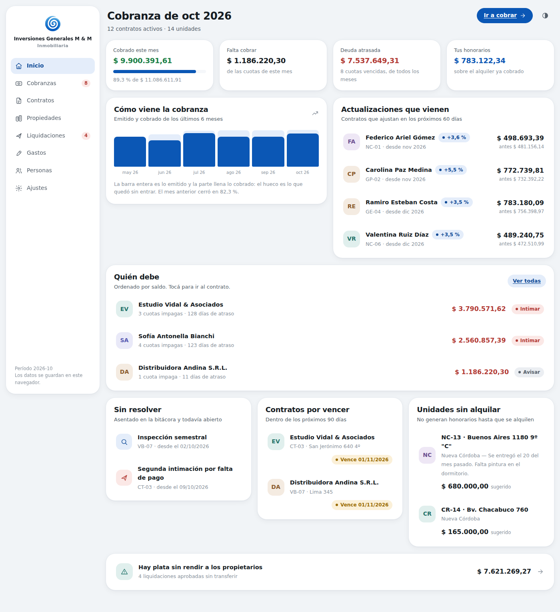

## El menú

Una pieza de vidrio que se pliega a una columna de íconos y se despliega con
nombres. Una pastilla se desliza hasta el ítem que se señala y vuelve sola
al de la pantalla actual. Abajo, «Modo noche» y el perfil (con «Cerrar
sesión» cuando hay servidor). Se acuerda si quedó plegado.

| Atajo | Qué hace |
|---|---|
| `Ctrl K` / `⌘ K` | Buscar una pantalla por nombre; Enter va a la primera |
| `Ctrl B` / `⌘ B` | Plegar o desplegar el menú |

En el celular es la barra de arriba, con el avatar al final.

## Arrancar

```bash
npm install
npm run dev        # http://localhost:5173
```

| Comando | Qué hace |
|---|---|
| `npm run build` | Chequea tipos y compila a `dist/` (sitio estático) |
| `npm run preview` | Sirve `dist/` en http://127.0.0.1:4173 |
| `npm run smoke` | Verificación de humo con Playwright (requiere `preview` levantado) |
| `npm run indices` | Trae el IPC de Córdoba publicado y actualiza `public/indices.json` |
| `npm run dominio` | Prueba las reglas puras: importe en letras, nombres de archivo, renovación |
| `npm run sincro` | Prueba el cálculo de diferencias contra Supabase |
| `npm run esquema` | Prueba el esquema SQL contra un Postgres efímero |

Arranca con una administración de ejemplo: 14 unidades, 12 contratos activos, un
año de cobranzas y liquidaciones. Desde **Ajustes → Respaldo** se vacía para
cargar datos reales.

### La marca

El logo vive en **`public/logo.png`** (y el del navegador en
`public/favicon.png`); el original sin recortar quedó en
`docs/logo-original.jpg`. Para cambiarlo, pisá esos archivos. Si el logo
faltara, el menú muestra un ícono genérico en vez de un cuadro roto.

El azul del logo es el acento de toda la app: está una sola vez, en
`--acento` dentro de `src/styles/tokens.css`.

El nombre viene puesto. **El CUIT, el teléfono y el email están en blanco a
propósito** —no los invento, porque se imprimen en las liquidaciones que recibe
el propietario—. Se cargan una vez en **Ajustes → Mis datos**.

### Publicada

<https://gestion.inversionesgeneralesmym.com.ar/> — cada push a la rama la
vuelve a desplegar con el workflow de GitHub Pages. El único paso manual, ya
hecho, es **Settings → Pages → Source: «GitHub Actions»**: con «Deploy from a
branch» el pipeline viejo pisa el deploy y sirve la página en blanco.

El dominio principal queda para la web pública de la inmobiliaria; la app vive
en un subdominio aparte y pide a los buscadores no indexarla (`robots.txt` y
`<meta name="robots">`). Cómo está armado:

- El dominio se registra en NIC.ar y está **delegado a Cloudflare**, que es
  donde se cargan los registros DNS.
- En Cloudflare: `CNAME gestion → agucami.github.io`, en **DNS only** (nube
  gris), para que GitHub pueda emitir el certificado HTTPS.
- En GitHub: **Settings → Pages → Custom domain** con el subdominio y
  **Enforce HTTPS** tildado. Con deploy por Actions no hace falta archivo
  `CNAME` en el repositorio.
- La dirección vieja, `agucami.github.io/web-app-inmo/`, redirige sola a la
  nueva. Cada navegador pide iniciar sesión otra vez, porque para él es otro
  sitio; los datos siguen en Supabase.

## Las pantallas

| Pantalla | Para qué |
|---|---|
| **Inicio** | Cuánto se cobró del mes, quién debe, qué contratos ajustan o vencen, qué unidades están vacías |
| **Cobranzas** | La cuota de cada inquilino del mes, con el botón de cobrar, los punitorios ya calculados y el recibo en PDF. No deja cobrar un mes si debe los anteriores |
| **Contratos** | Alta, renovación, cronograma de actualizaciones, cuotas con sus recibos, el legajo de archivos y la bitácora |
| **Propiedades** | La cartera, con su estado y el alquiler vigente |
| **Liquidaciones** | Lo que hay que transferirle a cada propietario: cobrado menos honorarios menos gastos, con su PDF |
| **Gastos** | Arreglos y servicios de cada unidad, para descontarlos de la liquidación |
| **Personas** | Propietarios, inquilinos y garantes |
| **Ajustes** | Tus datos, los índices mes a mes y el respaldo |

## Los dos modos: demo y cuentas

La app funciona de dos maneras, y lo decide el build, no el usuario:

| | **Modo demo** | **Modo cuentas** |
|---|---|---|
| Cuándo | sin variables de entorno | con las claves de Supabase |
| Login | no pide | email y contraseña |
| Dónde viven los datos | en ese navegador | en Supabase, online |
| Varias personas a la vez | no | sí, ven lo mismo |
| Qué queda en el disco | toda la base | nada |

El modo demo no es un resto: es la app que se muestra en una reunión sin
pedirle a nadie que se cree una cuenta, y es lo que está publicado en GitHub
Pages. Por eso el cliente de Supabase entra con import dinámico: son 59 kB
que la demo no descarga.

### Cómo se prende el modo cuentas

1. Crear un proyecto en [supabase.com](https://supabase.com), región South
   America (São Paulo).
2. **SQL Editor → New query**, pegar `supabase/esquema.sql` entero y *Run*.
   Crea las tablas, las políticas y también el bucket privado `adjuntos` de
   Storage, donde van los PDF y las fotos. Se puede volver a correr.
3. **Authentication → Users → Add user**, uno por persona, con *Auto Confirm
   User* tildado. Cada uno con su contraseña.
4. **SQL Editor:** pegar `supabase/usuarios.sql`, poner los emails reales
   donde dice `reemplazar-…` y *Run*. La consulta del final tiene que
   devolver una fila por persona.
5. **Project Settings → API**: copiar la *Project URL* y la clave *anon
   public*.
   - Para probar en la compu: a `.env.local` (ver `.env.ejemplo`) y
     `npm run dev`.
   - Para lo publicado: van en `.env.production`, que sí está en el
     repositorio (la clave anon es pública). Ojo: con ese archivo la
     dirección de GitHub Pages pide login y deja de mostrar la demo.
     Borrándolo vuelve a ser la demo.
6. Si ya había datos cargados en un navegador: bajar el respaldo ahí
   (**Ajustes → Respaldo**), entrar con cuenta y subirlo desde el mismo
   lugar. Las filas van a la base y los archivos que trae adentro, a Storage.

La clave `anon` es pública por diseño: viaja en el navegador y lo que protege
los datos son las políticas por fila del esquema. La `service_role` no va
nunca al repositorio ni al navegador.

### Qué pasa con la seguridad

Sin sesión no se ve nada: ni la app, ni un dato, ni entrando por una URL
directa. Y con servidor **la app no escribe nada en el navegador** — ni la
base, ni una copia—, así que cerrar sesión en una máquina compartida no deja
la cartera en el disco.

Del otro lado, cada tabla tiene una política que filtra por organización, y
las claves foráneas son compuestas: una inmobiliaria no puede leer, escribir
ni referenciar una fila de otra. Los archivos siguen la misma regla: van a
`adjuntos/<organización>/<id>` y las políticas de Storage solo dejan tocar
la carpeta de la inmobiliaria propia. El bucket es privado: no hay enlace
público a un contrato escaneado. Está todo probado en `npm run esquema`.

### Cuándo se guarda

No hay botón de guardar: cada cambio sale solo. Se espera un momento antes de
mandar —escribir un nombre dispara una mutación por tecla— y el punto de
referencia solo avanza cuando el servidor confirma, así que una escritura que
falla se reintenta entera en vez de darse por guardada.

Si algo no se pudo guardar, aparece un aviso que no se puede ignorar y el
navegador pregunta antes de cerrar la pestaña. Lo peor que podría hacer la
app es mostrar los datos como si estuvieran guardados cuando no lo están.

## Empezar a cargar datos reales

La app arranca con una administración de ejemplo. Para pasar a lo real, una
sola vez:

1. **Abrir siempre desde la misma computadora y el mismo navegador.** No hay
   cuentas todavía: los datos viven en ese navegador y no se sincronizan.
   Conviene dejarlo en Favoritos.
2. **Ajustes → Respaldo → Empezar de cero.** Borra el ejemplo. En ese momento
   la app le pide al navegador que no descarte los datos.
3. **Ajustes → Mis datos:** nombre, CUIT, teléfono y email. Se imprimen en
   los recibos y en las liquidaciones.
4. **Cargar en este orden:** personas (propietarios e inquilinos) →
   propiedades → contratos. Cada paso necesita el anterior.
5. **Cobranzas → Emitir cuotas** genera las del mes.

Ojo: no hay barra que avise que los datos son de ejemplo —se sacó para
despejar la pantalla—. Es fácil empezar a cargar propiedades de verdad
encima de la demo y después no poder distinguirlas, así que conviene vaciar
antes de empezar.

### El respaldo no es opcional

Los datos están en el navegador. Si alguien limpia los datos del sitio, o se
reinstala la máquina, **no hay de dónde recuperarlos**: no están en ningún
servidor. La única red es el archivo que se baja desde Ajustes → Respaldo,
que incluye también los contratos escaneados.

La app ya no lo recuerda con una barra arriba —se sacó para despejar la
pantalla—, así que depende de que alguien se acuerde de bajarla: al menos
una vez por semana.

En **Ajustes → Respaldo → Dónde viven los datos** se ve si el navegador se
comprometió a no descartarlos. Chrome lo concede según cuánto se use el
sitio; tenerlo en Favoritos o instalado como aplicación ayuda.

Todo esto deja de hacer falta en modo cuentas: los datos y los archivos
quedan en Supabase. Ver «Cómo se prende el modo cuentas».

## Las decisiones que explican el resto

**El alquiler vigente se calcula, no se guarda.** El contrato guarda el monto
inicial, el índice y cada cuántos meses ajusta. El cronograma sale de encadenar
los coeficientes del índice publicado:

```
monto(k) = monto(k−1) × índice(períodoTramo k) / índice(períodoTramo k−1)
```

Cuando entra el dato definitivo del mes, todos los contratos que usan ese índice
se recalculan solos, incluidas las proyecciones a futuro.

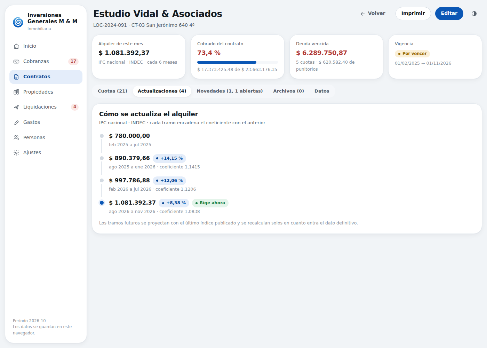

**El índice es por contrato.** Si el contrato dice ICL, actualizar por IPC de
Córdoba no es válido. Cada contrato elige el suyo y la app respeta esa elección.

**Se liquida lo cobrado, y de a partes.** Cada ítem de liquidación guarda qué
fracción de la cuota está rindiendo. Si el inquilino pagó la mitad, se rinde la
mitad; cuando paga el resto, una liquidación complementaria toma la diferencia.
Apretar «Generar» dos veces no duplica nada.

**Los PDF no van en `localStorage`.** Guarda solo texto y el límite ronda los
5 MB para toda la base: un contrato escaneado ya lo revienta. Los binarios van a
IndexedDB y en la base principal queda nada más que la ficha del archivo. El
respaldo que bajás de Ajustes los lleva adentro, así que una copia no es una
copia a medias.

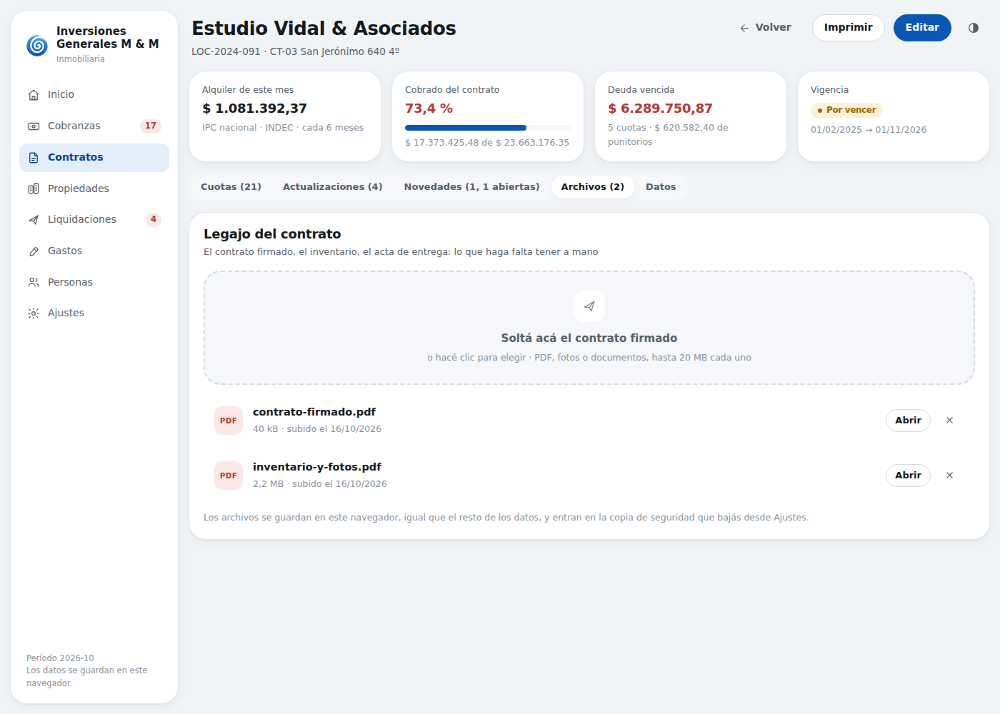

**La bitácora del contrato es la memoria de la unidad.** El inquilino avisa de
una filtración, se hace una inspección, se manda una intimación: queda asentado
con fecha, tipo y detalle, con fotos o presupuestos colgados. Lo que quedó
abierto aparece en Inicio, porque es lo primero que se olvida.

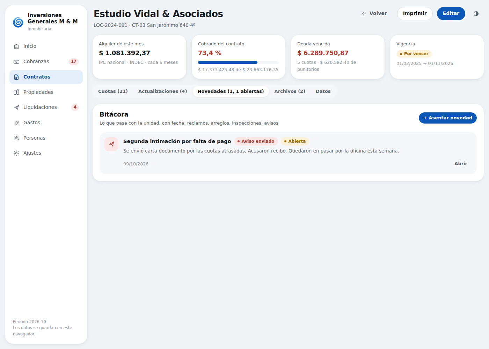

**Cobrar emite el recibo.** El botón dice «Cobrar y dar recibo» porque hace
las dos cosas: registra la cobranza y baja el PDF para mandárselo al
inquilino. Los ya emitidos se vuelven a bajar desde el botón **Recibos** de
cada cuota, en el contrato — que es a donde lleva «Ver» desde Cobranzas.

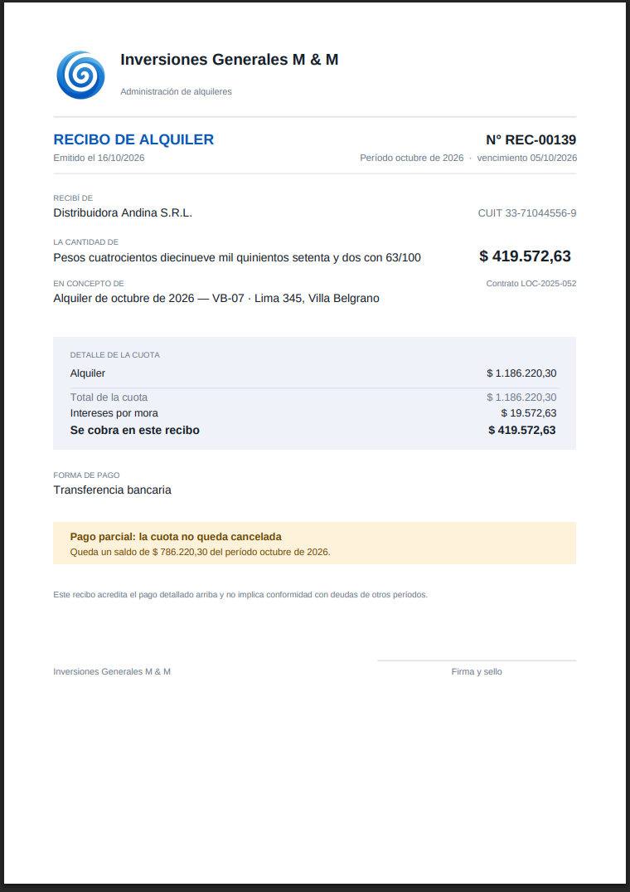

El número lo pone la app —`REC-00139`, correlativo— y queda guardado con el
pago: **reimprimir un recibo devuelve el mismo archivo, byte a byte**, no uno
nuevo con otro número. El campo «Comprobante» es otra cosa: es la referencia
de la transferencia que trae el inquilino.

Un recibo por un pago parcial que no aclara el saldo parece cancelar la cuota
entera, así que cuando queda algo sin pagar el PDF lo dice en un recuadro, con
el monto y el período.

**Renovar es crear un contrato nuevo, no estirar el viejo.** El cronograma
encadena los coeficientes desde el monto inicial, así que estirarle la fecha
de fin al contrato que vence seguiría actualizando sobre el alquiler de hace
dos años. El contrato nuevo arranca por el alquiler que regía al final, y el
anterior queda cerrado con sus cuotas, recibos y liquidaciones intactos, que
es lo que hay que poder mostrar si algo se discute.

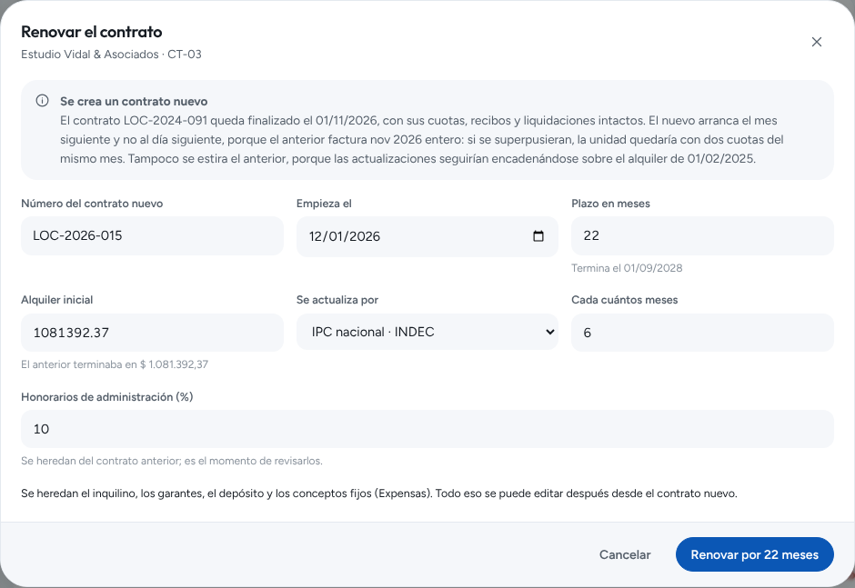

Arranca **el mes siguiente**, no el día siguiente. Un contrato que termina el
1 de noviembre igual factura noviembre entero: si el nuevo empezara el 2, la
unidad quedaría con dos cuotas del mismo mes. La fecha se puede editar, y si
se la pisa dentro del mes del anterior el formulario lo frena.

**No se cobra un mes si debe los anteriores.** El artículo 899 inc. b del
Código Civil y Comercial presume, salvo prueba en contrario, que si se da
recibo por un período **los anteriores están cancelados**. Dar el recibo de
noviembre con octubre impago es, en los hechos, regalar octubre. Así que la
app frena el cobro, dice cuánto y de qué meses se adeuda, y ofrece ir a
cobrar el más viejo de un clic.

Frenar sin salida sería peor: hay casos legítimos —un plan de pago, un
período en discusión— en los que se cobra igual. Se puede, tildando una
casilla, y entonces el recibo sale con la reserva del artículo 898 nombrando
los períodos impagos y aclarando que no quedan cancelados. Esos períodos se
guardan en el pago, no se recalculan: el recibo tiene que decir lo que decía
el día que se entregó, aunque el inquilino después se ponga al día.

La regla es **por contrato**: un inquilino con dos unidades tiene dos deudas
distintas.

**El propietario también recibe su papel.** El recibo es para el inquilino;
la liquidación es el documento que justifica tu comisión, y es lo que el
propietario mira todos los meses. Sale en PDF desde la liquidación, con el
detalle por unidad, los honorarios y los gastos descontados, el neto en
números y en letras, y el CBU adonde va la transferencia.

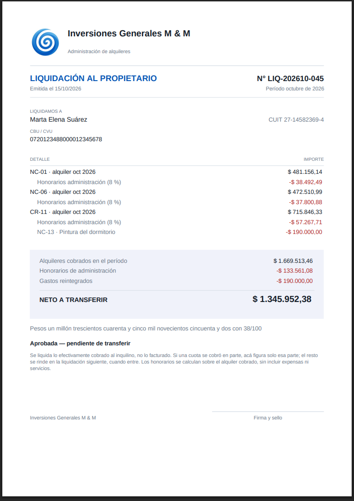

Lleva escrito el criterio —se rinde lo **cobrado**, no lo facturado— porque es
la pregunta que todo propietario hace cuando el número no coincide con el
alquiler. Mejor que esté en el papel y no en una llamada.

**El PDF se escribe a mano, sin librería.** `domain/pdf.ts` son 250 líneas que
hacen lo que un recibo necesita: una hoja A4, las tipografías base que todo
lector de PDF ya trae, texto alineado, líneas, recuadros y el logo embebido
como JPEG. jsPDF pesa más que toda esta app junta; esto suma 6 kB. El importe
va también en letras, que es lo que evita que a un recibo le agreguen un cero
después de firmado.

Un detalle que costó encontrar: **Chrome descarta el nombre del archivo entero
si tiene un solo carácter fuera de ASCII**. «Recibo REC-7 - Julieta Ávila.pdf»
se bajaba como `download`, sin nombre ni extensión, para la mitad de los
inquilinos. Los nombres de archivo salen sin acentos a propósito.

**Los honorarios salen del alquiler cobrado, no de la cuota entera.** Las
expensas se las lleva el consorcio: cobrarles comisión sería cobrar de más.

**Borrar arrastra lo que dependía.** La base es un objeto plano en el navegador,
sin claves foráneas: si el borrado filtrara una sola colección, las cuotas de un
contrato borrado seguirían contando para siempre. `domain/integridad.ts` es la
única fuente de verdad sobre qué depende de qué — corre después de cada borrado
y también al abrir la app, así repara sola cualquier base que haya quedado
inconsistente.

Antes de borrar hay confirmación, y dice cuánto se lleva puesto. Ese detalle se
calcula simulando el borrado con el mismo código que después lo ejecuta, así lo
que promete el cartel es exactamente lo que pasa.

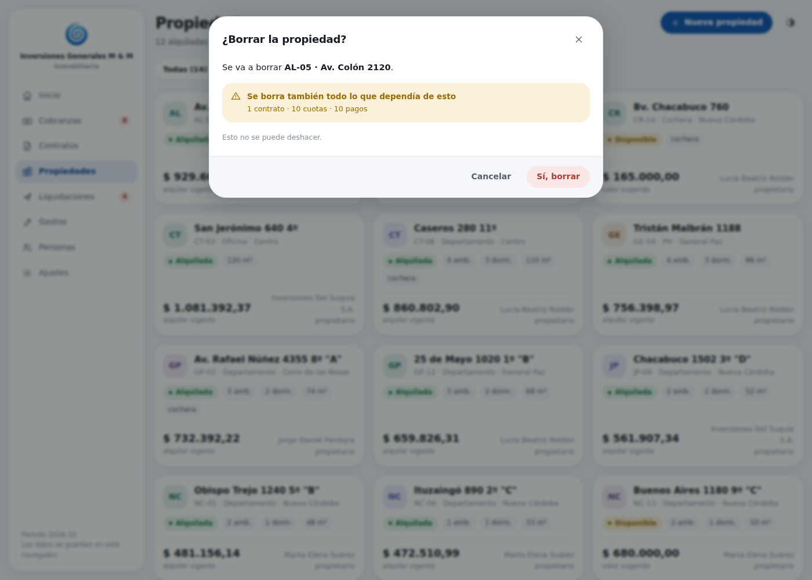

## El IPC de Córdoba, actualizado solo

Lo trae **el navegador de quien abre la app**, directo del portal de datos de
la Dirección General de Estadística y Censos (`datosestadistica.cba.gov.ar`,
dataset `indic`). Pasa al abrir la app —con cuentas, apenas se inicia
sesión— y con **Ajustes → Índices → Buscar ahora**.

Por qué desde el navegador y no desde un servidor: el portal **no les contesta
a los servidores de afuera de Argentina**. A GitHub Actions, que corre en
Estados Unidos, le devuelve 404 en todas las rutas; a una compu en Córdoba le
contesta normal. Y como el API de CKAN no manda permisos CORS, se le pide por
**JSONP** (`callback=`), que sí acepta.

```
abrir la app → package_show (qué planillas hay)
             → datastore_search de cada una (JSONP)
             → el CSV, por si trae meses más nuevos (si el portal da CORS)
             → unir, controlar, volcar en la columna IPC_CBA
```

Lo que cuida (`src/domain/ipcCordoba.ts`, probado en `npm run dominio`):

- **La base.** En 2026 la Provincia pasó de *2014 = 100* a *jun-nov 2025 =
  100*. Mezclar las dos haría que un ajuste multiplique por 60 en vez de por
  1,05. Se usan solo las planillas en la base nueva: la **serie empalmada**
  (que lleva la historia a esa base) y la mensual. Cada planilla extra solo se
  suma si coincide con las anteriores en los meses que comparten; si no, se
  descarta entera.
- **Que los números sean creíbles.** Una variación mensual de menos de −10 %
  o más de +50 % frena todo y no se toca nada.
- **El dato oficial manda.** Pisa lo cargado a mano en esos meses. Un mes que
  no existía se crea con el IPC de Córdoba y los otros índices en 0, que el
  cálculo lee como «sin publicar» y resuelve arrastrando el último valor.
- **La tabla del datastore se atrasa.** La Provincia no siempre la refresca
  (en noviembre de 2026 llegaba a julio, y el archivo, a septiembre). Por eso
  también se baja el CSV. El portal no manda permisos CORS para los archivos,
  así que el navegador no deja leerlos directo: pasan por un intermediario en
  Cloudflare, `cloudflare/proxy-ipc.js`. Sin él, quedan los meses del
  datastore y los que falten se cargan con **Agregar mes**.

### El intermediario en Cloudflare

Un Worker gratuito que baja los índices y se los pasa a la app con el permiso
CORS puesto. Solo acepta tres fuentes —la planilla del IPC de Córdoba, el ICL
del BCRA y el IPC nacional del INDEC— y solo le contesta a la app. Cada vez
que cambia `cloudflare/proxy-ipc.js` hay que volver a pegarlo en Cloudflare.

1. Cloudflare → **Compute (Workers)** → **Create** → **Start with Hello
   World** → nombre `ipc-cordoba` → **Deploy**.
2. **Edit code**, borrar todo, pegar `cloudflare/proxy-ipc.js` → **Deploy**.
3. Copiar la dirección que queda (`https://ipc-cordoba.<cuenta>.workers.dev`)
   en `.env.production` como `VITE_PROXY_IPC=` y publicar.

### El ICL y el IPC nacional

También se traen solos, por el mismo intermediario de Cloudflare
(`src/data/indicesNacionales.ts`):

| Índice | Fuente | Qué se toma |
|---|---|---|
| ICL | API de estadísticas del BCRA, variable 40 (prueba la v4 y si no, la v3) | El valor del día 1 de cada mes, o el primero publicado de ese mes. El ICL es diario; la app trabaja por mes |
| IPC nacional | API de series de tiempo de datos.gob.ar, serie `148.3_INIVELNAL_DICI_M_26` (INDEC, base dic 2016 = 100) | El índice mensual, redondeado a un decimal |

Pasan por el mismo control de variaciones que el IPC de Córdoba, y si una
fuente falla las otras se aplican igual. **Casa Propia** sigue a mano: el
Ministerio lo publica como un coeficiente suelto, sin API ni planilla estable.

La tarea programada de GitHub (`.github/workflows/indices.yml`) sigue
existiendo para cuando el portal vuelva a contestarle a servidores de afuera;
hoy termina sin hacer nada.

## Cómo está armado

```
src/
├── domain/          Las reglas, sin React ni almacenamiento
│   ├── types.ts         Modelo de datos
│   ├── util.ts          Fechas, períodos, plata, formato es-AR
│   ├── contratos.ts     Cronograma de ajustes, índices, vigencia
│   ├── cobranzas.ts     Emisión de cuotas, punitorios, mora, recibos
│   ├── liquidaciones.ts Rendición a propietarios (incremental)
│   ├── pdf.ts           Escritor de PDF mínimo, sin dependencias
│   ├── documento.ts     Membrete, colores y medidas que comparten los PDF
│   ├── letras.ts        El importe escrito con todas las letras
│   ├── recibo.ts        Qué dice y cómo se ve el recibo de alquiler
│   ├── liquidacion-pdf.ts  Lo mismo para la liquidación al propietario
│   └── resumen.ts       Los números de Inicio
├── data/            Persistencia, índices y datos de ejemplo
├── components/      Kit de interfaz e íconos
├── pages/           Una pantalla por sección
└── styles/          Tokens de diseño y hoja principal
```

Todo el cálculo vive en `domain/` como funciones puras sobre la base de datos.
Son las que conviene cubrir con tests y las que se mudan tal cual el día que haya
backend.

**Stack:** React 18 + TypeScript + Vite, Zustand, CSS propio con tokens. Sin
librería de componentes y sin librería de gráficos.

## Detalles de la interfaz

- Modo claro y oscuro, cada uno con su propia paleta. El interruptor está arriba
  a la derecha.
- Listas de tarjetas en vez de grillas: se lee como una app, no como una planilla.
- Los estados siempre llevan texto además de color.
- En las listas donde no todas las filas traen los mismos botones, la columna
  de acciones tiene ancho fijo: si se achicara con el contenido, los importes
  de cada fila terminarían en una x distinta y la lista se vería chueca.
- Anda hasta 390 px de ancho y tiene hoja de impresión para contratos y
  liquidaciones.

## En la lista, decidido pero sin hacer

Cosas que ya se evaluaron y están esperando el momento, con lo que se averiguó
para no volver a discutirlo desde cero.

**Aviso de cobranza por WhatsApp.** Un botón que abra WhatsApp con el mensaje
ya escrito: «Hola Carolina, el alquiler de noviembre es $X y vence el 10».
Se hace con un enlace `wa.me`, que es **gratis**: no necesita la API de
WhatsApp Business, ni cuenta de empresa, ni registro. El mensaje lo manda la
persona, no el sistema. La API paga —por mensaje enviado desde julio de 2025—
haría falta solo el día que se quiera que salgan solos, sin que nadie los
mire.

**Estado de cuenta del inquilino en PDF**, para cuando alguien pide «mandame
todo lo que debo». La maquinaria de PDF ya está; falta el documento.

**El CUIT, el teléfono y el email de la inmobiliaria** siguen en blanco a
propósito: se imprimen en los recibos y en las liquidaciones, así que no se
inventan. Se cargan en Ajustes → Mis datos.

## La variante «vidrio líquido»

Un experimento, **apagado por defecto**. Se prueba agregando `?vidrio` a la
dirección: <https://gestion.inversionesgeneralesmym.com.ar/?vidrio>

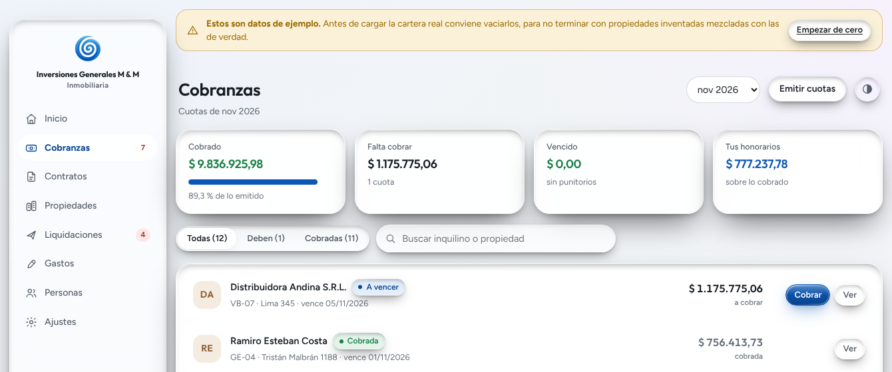
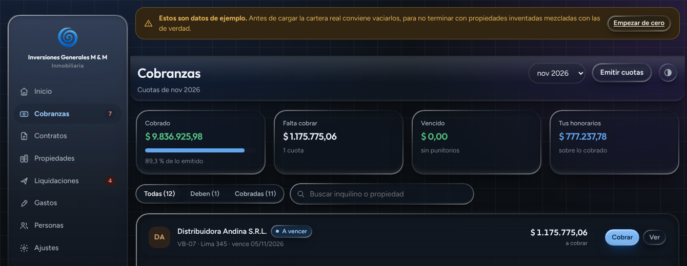

La regla que lo ordena: **el vidrio va en el cromo —el menú, los controles,
los diálogos— y no en el contenido.** Los paneles están llenos de importes
que hay que leer de una ojeada, y una superficie translúcida sobre un fondo
con color les baja el contraste. El material es para navegar, no para leer
números. Es lo que recomienda Apple para su propio Liquid Glass: *keep
content on a separate layer*.

Medido, no supuesto: se fotografió lo que hay detrás de cada texto con el
texto escondido, se promedió el color real y se calculó el contraste WCAG.
Con vidrio da igual que sin vidrio —5,0:1 y 4,5:1 en los textos chicos—
justamente porque el contenido quedó casi opaco.

Respeta `prefers-reduced-transparency`: quien pidió menos transparencia en
su sistema recibe superficies opacas. Y al imprimir se desactiva entero, que
si no los recibos salen grises.

### La refracción es real


La pieza de la derecha deforma el fondo: las barras de adentro no coinciden
con las de afuera. Eso es una lente, y es lo que separa el material de Apple
de un vidrio esmerilado.

Se hace con `feDisplacementMap`: un filtro SVG que corre cada píxel del fondo
según un mapa, donde el canal rojo lo mueve en horizontal y el verde en
vertical. El mapa vale 128 en el centro —no mover— y 0 o 255 en los bordes
—empujar—. Se estira con `preserveAspectRatio="none"`, así un solo filtro
sirve para un botón y para un diálogo.

**Solo anda en Chromium.** Safari y Firefox no resuelven filtros SVG dentro
de `backdrop-filter` y descartan la regla, con lo que queda el desenfoque de
la regla anterior: degradación, no rotura. La ironía es que el navegador de
Apple es el que no puede mostrar el material de Apple.

### Los tres modos, y lo que cuesta cada uno

| | Cómo se prende | Se lee | Se ve |
|---|---|---|---|
| Claro con volumen | `?vidrio` | **5,0:1** | fondo claro, piezas con espesor y sombra. Es el bueno |
| Saturado | `?vidrio=max` | 3,4:1 | fondo de colores. Se ve más, se lee peor |
| Sin lente | `?vidrio=simple` | 5,0:1 | solo desenfoque, anda en todos los navegadores |

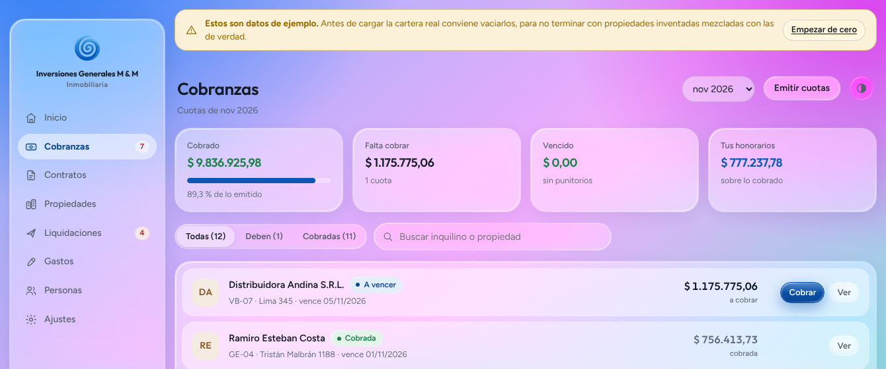

### Dónde se ve, y por qué en las tarjetas no

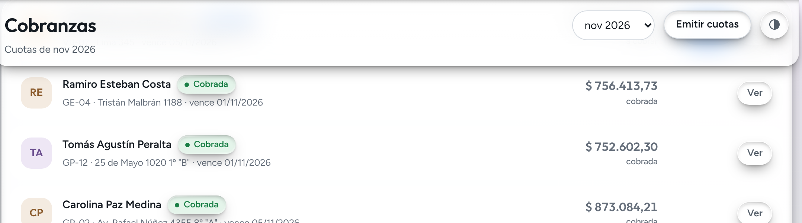

Ahí se lee el texto de una fila **a través** de la cabecera, desenfocado y
corrido por la lente. Eso es el material funcionando.

El punto que costó entender: **una superficie translúcida sobre un fondo
vacío se ve igual que una opaca.** No hay nada que dejar pasar. En las
imágenes de Apple las piezas se superponen entre sí y las barras de color
pasan por debajo; por eso se lee la transparencia.

En esta app eso pasa en tres lugares, y en ninguno hay importes que leer a
través del material:

- **la cabecera**, que ahora es pegajosa y el listado se desliza por debajo;
- **el menú**, con la página scrolleando al lado;
- **el diálogo**, encima del listado.

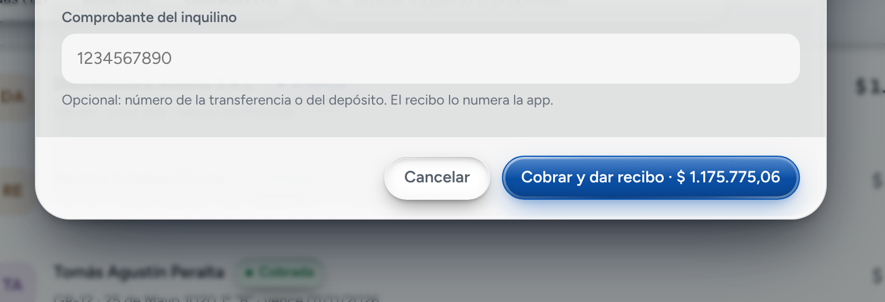

Las tarjetas de datos quedaron fuera a propósito: están apoyadas
directamente sobre el fondo, no tienen nada detrás que mostrar, y el
material solo les sacaba contraste a los importes.

### La opacidad: lo que de verdad lo tenía plano

Las superficies estaban en 93 % de opacidad. Una superficie opaca no deja
ver nada detrás, así que todo el material —la lente, el canto, las sombras—
estaba tapado por una pared blanca. **Bajarlas a 25 % fue el cambio que más
se nota de todos.**

Medido antes de bajarlas, barriendo niveles sobre este fondo claro:

| Opacidad del panel | Importe | Subtítulo |
|---|---|---|
| 93 % | 5,0:1 | 5,0:1 |
| 60 % | 4,8:1 | 4,9:1 |
| 40 % | 4,7:1 | 4,8:1 |
| **25 %** | **4,6:1** | **4,7:1** |
| 12 % | 4,6:1 | 4,6:1 |

La conclusión corrige una anterior: **lo que rompía la legibilidad no era la
transparencia, era el fondo de colores.** Sobre un fondo claro se puede bajar
hasta el 12 % y el texto sigue cumpliendo, porque lo que se filtra también es
claro. Quedó en 25 %, que deja margen y le da algo de cuerpo a la superficie.

### Lo que resolvió el empate: la sombra, no el color

Durante un rato la conclusión fue que había que elegir entre que se viera
el vidrio o que se leyeran los importes. Estaba mal, y lo destrabó mirar
bien la referencia de Apple: **ahí el fondo es claro.** Lo que hace que esas
piezas parezcan vidrio no es el color de atrás, son dos cosas:

- **La sombra proyectada.** Las piezas no flotan por el desenfoque: flotan
  porque tiran sombra y tienen espesor. Son cuatro sombras que describen un
  vidrio iluminado desde arriba — la que proyecta sobre la página, una corta
  que la apoya, una interior bajo el canto de arriba que es el espesor visto
  desde adentro, y un rebote de luz en el canto de abajo.
- **Una retícula tenue en el fondo.** Una lente sobre un blanco plano es
  invisible: no hay nada que deformar. Las líneas finas se doblan al pasar
  por el canto y es ahí donde se ve la refracción, sin ensuciar la lectura
  como sí lo hace un color saturado.

Con eso, `?vidrio` mantiene los importes en 5,0:1 y aun así se ve el
material. `?vidrio=max` queda como la versión llamativa, para una pantalla
sin números.

Lo que cuesta: `backdrop-filter` en muchos elementos a la vez es trabajo para
la placa de video. En una lista larga en un celular viejo se puede notar.

## Lo que no hace

- **Un solo usuario, un solo navegador.** No hay login ni sincronización.
- **No emite comprobantes fiscales** ni tiene libro IVA.
- **Los valores de índice que trae la demo son inventados** (plausibles, pero
  inventados). Hay que reemplazarlos antes de usarla en serio.
