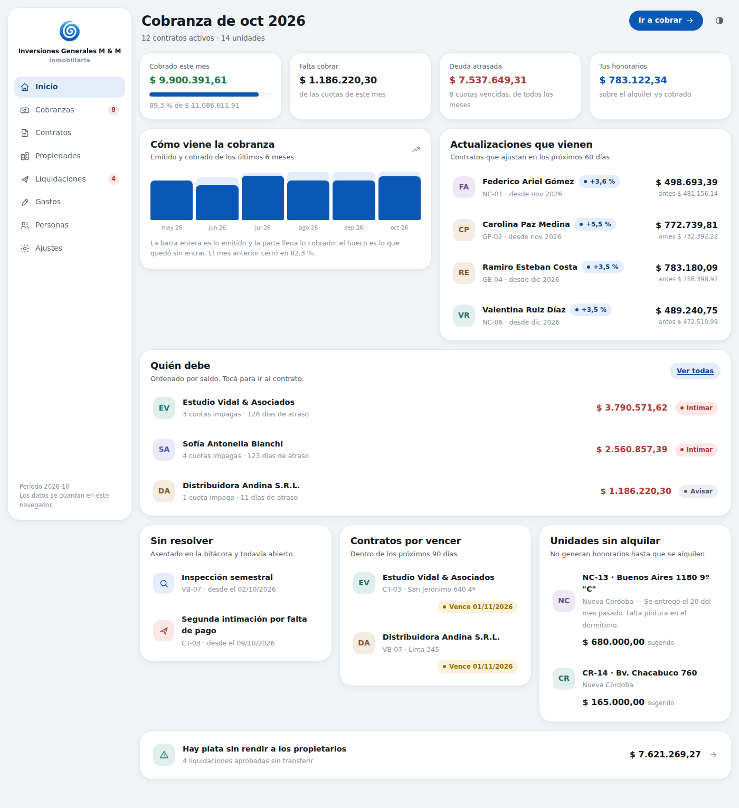
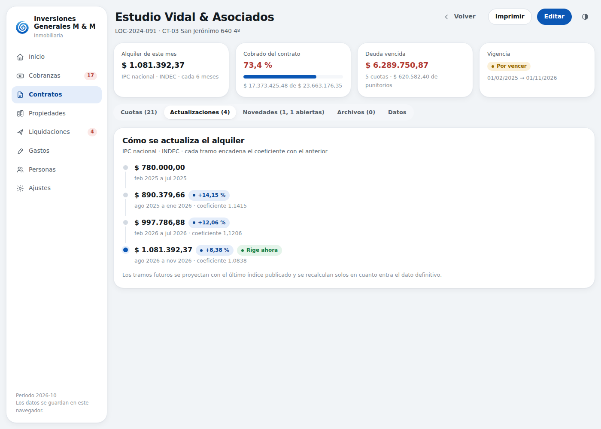
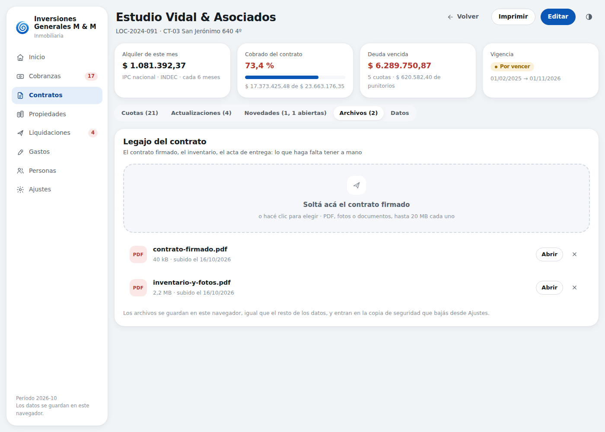
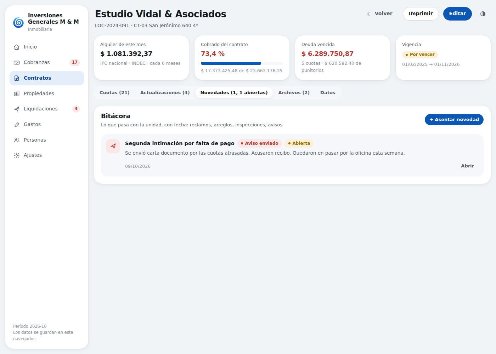
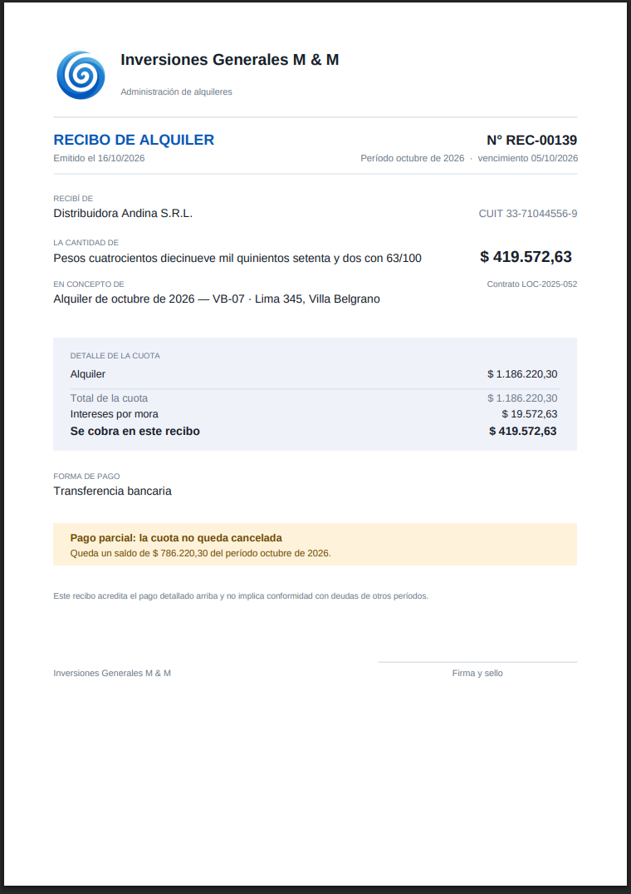
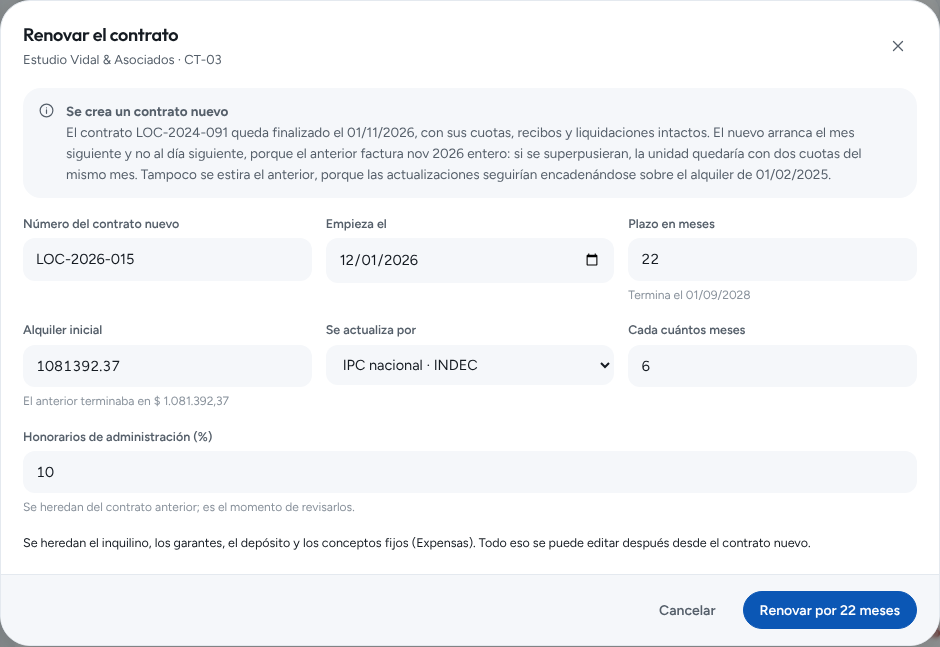
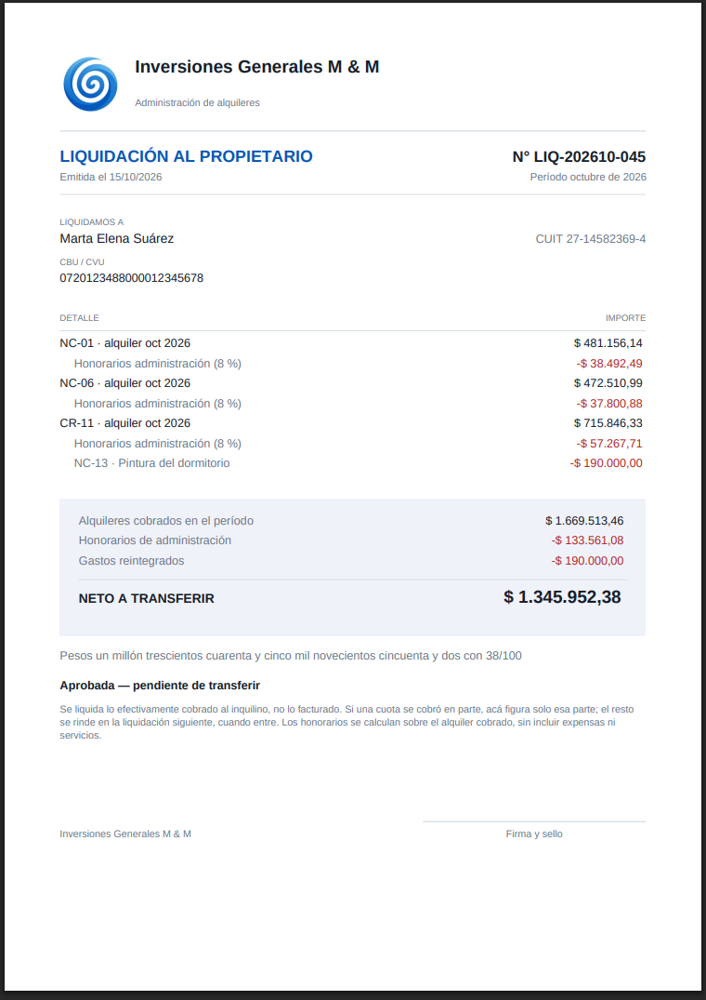
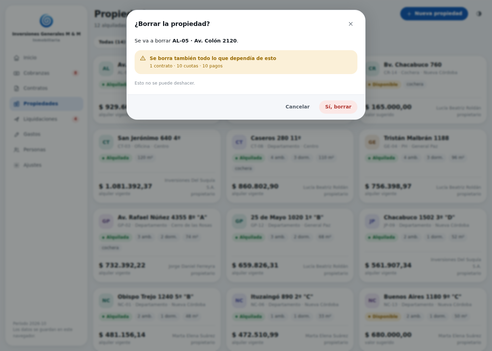

# Inversiones Generales M & M — Alquileres


Web app para administrar los alquileres de **Inversiones Generales M & M
Inmobiliaria**: contratos, actualizaciones por índice, cobranza mes a mes y
liquidación a los propietarios. Pensada para Córdoba, Argentina: incluye el
**IPC de Córdoba** como índice de actualización, junto al ICL del BCRA, el IPC
nacional y el porcentaje fijo.

No hay servidor ni cuentas: los datos viven en el navegador y se respaldan en un
archivo.



## Arrancar

```bash
npm install
npm run dev        # http://localhost:5173
```

| Comando | Qué hace |
|---|---|
| `npm run build` | Chequea tipos y compila a `dist/` (sitio estático) |
| `npm run preview` | Sirve `dist/` en http://127.0.0.1:4173 |
| `npm run smoke` | Verificación de humo con Playwright (requiere `preview` levantado) |
| `npm run indices` | Trae el IPC de Córdoba publicado y actualiza `public/indices.json` |
| `npm run dominio` | Prueba las reglas puras: importe en letras, nombres de archivo, renovación |
| `npm run sincro` | Prueba el cálculo de diferencias contra Supabase |
| `npm run esquema` | Prueba el esquema SQL contra un Postgres efímero |

Arranca con una administración de ejemplo: 14 unidades, 12 contratos activos, un
año de cobranzas y liquidaciones. Desde **Ajustes → Respaldo** se vacía para
cargar datos reales.

### La marca

El logo vive en **`public/logo.png`** (y el del navegador en
`public/favicon.png`); el original sin recortar quedó en
`docs/logo-original.jpg`. Para cambiarlo, pisá esos archivos. Si el logo
faltara, el menú muestra un ícono genérico en vez de un cuadro roto.

El azul del logo es el acento de toda la app: está una sola vez, en
`--acento` dentro de `src/styles/tokens.css`.

El nombre viene puesto. **El CUIT, el teléfono y el email están en blanco a
propósito** —no los invento, porque se imprimen en las liquidaciones que recibe
el propietario—. Se cargan una vez en **Ajustes → Mis datos**.

### Publicada

<https://agucami.github.io/web-app-inmo/> — cada push a la rama la vuelve a
desplegar con el workflow de GitHub Pages. El único paso manual, ya hecho, es
**Settings → Pages → Source: «GitHub Actions»**: con «Deploy from a branch» el
pipeline viejo pisa el deploy y sirve la página en blanco.

## Las pantallas

| Pantalla | Para qué |
|---|---|
| **Inicio** | Cuánto se cobró del mes, quién debe, qué contratos ajustan o vencen, qué unidades están vacías |
| **Cobranzas** | La cuota de cada inquilino del mes, con el botón de cobrar, los punitorios ya calculados y el recibo en PDF. No deja cobrar un mes si debe los anteriores |
| **Contratos** | Alta, renovación, cronograma de actualizaciones, cuotas con sus recibos, el legajo de archivos y la bitácora |
| **Propiedades** | La cartera, con su estado y el alquiler vigente |
| **Liquidaciones** | Lo que hay que transferirle a cada propietario: cobrado menos honorarios menos gastos, con su PDF |
| **Gastos** | Arreglos y servicios de cada unidad, para descontarlos de la liquidación |
| **Personas** | Propietarios, inquilinos y garantes |
| **Ajustes** | Tus datos, los índices mes a mes y el respaldo |

## Las decisiones que explican el resto

**El alquiler vigente se calcula, no se guarda.** El contrato guarda el monto
inicial, el índice y cada cuántos meses ajusta. El cronograma sale de encadenar
los coeficientes del índice publicado:

```
monto(k) = monto(k−1) × índice(períodoTramo k) / índice(períodoTramo k−1)
```

Cuando entra el dato definitivo del mes, todos los contratos que usan ese índice
se recalculan solos, incluidas las proyecciones a futuro.



**El índice es por contrato.** Si el contrato dice ICL, actualizar por IPC de
Córdoba no es válido. Cada contrato elige el suyo y la app respeta esa elección.

**Se liquida lo cobrado, y de a partes.** Cada ítem de liquidación guarda qué
fracción de la cuota está rindiendo. Si el inquilino pagó la mitad, se rinde la
mitad; cuando paga el resto, una liquidación complementaria toma la diferencia.
Apretar «Generar» dos veces no duplica nada.

**Los PDF no van en `localStorage`.** Guarda solo texto y el límite ronda los
5 MB para toda la base: un contrato escaneado ya lo revienta. Los binarios van a
IndexedDB y en la base principal queda nada más que la ficha del archivo. El
respaldo que bajás de Ajustes los lleva adentro, así que una copia no es una
copia a medias.



**La bitácora del contrato es la memoria de la unidad.** El inquilino avisa de
una filtración, se hace una inspección, se manda una intimación: queda asentado
con fecha, tipo y detalle, con fotos o presupuestos colgados. Lo que quedó
abierto aparece en Inicio, porque es lo primero que se olvida.



**Cobrar emite el recibo.** El botón dice «Cobrar y dar recibo» porque hace
las dos cosas: registra la cobranza y baja el PDF para mandárselo al
inquilino. Los ya emitidos se vuelven a bajar desde el botón **Recibos** de
cada cuota, en el contrato — que es a donde lleva «Ver» desde Cobranzas.



El número lo pone la app —`REC-00139`, correlativo— y queda guardado con el
pago: **reimprimir un recibo devuelve el mismo archivo, byte a byte**, no uno
nuevo con otro número. El campo «Comprobante» es otra cosa: es la referencia
de la transferencia que trae el inquilino.

Un recibo por un pago parcial que no aclara el saldo parece cancelar la cuota
entera, así que cuando queda algo sin pagar el PDF lo dice en un recuadro, con
el monto y el período.

**Renovar es crear un contrato nuevo, no estirar el viejo.** El cronograma
encadena los coeficientes desde el monto inicial, así que estirarle la fecha
de fin al contrato que vence seguiría actualizando sobre el alquiler de hace
dos años. El contrato nuevo arranca por el alquiler que regía al final, y el
anterior queda cerrado con sus cuotas, recibos y liquidaciones intactos, que
es lo que hay que poder mostrar si algo se discute.



Arranca **el mes siguiente**, no el día siguiente. Un contrato que termina el
1 de noviembre igual factura noviembre entero: si el nuevo empezara el 2, la
unidad quedaría con dos cuotas del mismo mes. La fecha se puede editar, y si
se la pisa dentro del mes del anterior el formulario lo frena.

**No se cobra un mes si debe los anteriores.** El artículo 899 inc. b del
Código Civil y Comercial presume, salvo prueba en contrario, que si se da
recibo por un período **los anteriores están cancelados**. Dar el recibo de
noviembre con octubre impago es, en los hechos, regalar octubre. Así que la
app frena el cobro, dice cuánto y de qué meses se adeuda, y ofrece ir a
cobrar el más viejo de un clic.

Frenar sin salida sería peor: hay casos legítimos —un plan de pago, un
período en discusión— en los que se cobra igual. Se puede, tildando una
casilla, y entonces el recibo sale con la reserva del artículo 898 nombrando
los períodos impagos y aclarando que no quedan cancelados. Esos períodos se
guardan en el pago, no se recalculan: el recibo tiene que decir lo que decía
el día que se entregó, aunque el inquilino después se ponga al día.

La regla es **por contrato**: un inquilino con dos unidades tiene dos deudas
distintas.

**El propietario también recibe su papel.** El recibo es para el inquilino;
la liquidación es el documento que justifica tu comisión, y es lo que el
propietario mira todos los meses. Sale en PDF desde la liquidación, con el
detalle por unidad, los honorarios y los gastos descontados, el neto en
números y en letras, y el CBU adonde va la transferencia.



Lleva escrito el criterio —se rinde lo **cobrado**, no lo facturado— porque es
la pregunta que todo propietario hace cuando el número no coincide con el
alquiler. Mejor que esté en el papel y no en una llamada.

**El PDF se escribe a mano, sin librería.** `domain/pdf.ts` son 250 líneas que
hacen lo que un recibo necesita: una hoja A4, las tipografías base que todo
lector de PDF ya trae, texto alineado, líneas, recuadros y el logo embebido
como JPEG. jsPDF pesa más que toda esta app junta; esto suma 6 kB. El importe
va también en letras, que es lo que evita que a un recibo le agreguen un cero
después de firmado.

Un detalle que costó encontrar: **Chrome descarta el nombre del archivo entero
si tiene un solo carácter fuera de ASCII**. «Recibo REC-7 - Julieta Ávila.pdf»
se bajaba como `download`, sin nombre ni extensión, para la mitad de los
inquilinos. Los nombres de archivo salen sin acentos a propósito.

**Los honorarios salen del alquiler cobrado, no de la cuota entera.** Las
expensas se las lleva el consorcio: cobrarles comisión sería cobrar de más.

**Borrar arrastra lo que dependía.** La base es un objeto plano en el navegador,
sin claves foráneas: si el borrado filtrara una sola colección, las cuotas de un
contrato borrado seguirían contando para siempre. `domain/integridad.ts` es la
única fuente de verdad sobre qué depende de qué — corre después de cada borrado
y también al abrir la app, así repara sola cualquier base que haya quedado
inconsistente.

Antes de borrar hay confirmación, y dice cuánto se lleva puesto. Ese detalle se
calcula simulando el borrado con el mismo código que después lo ejecuta, así lo
que promete el cartel es exactamente lo que pasa.



## El IPC de Córdoba, actualizado solo

La app es un sitio estático. El navegador no puede pedirle los datos al organismo
—CORS, y el sitio puede estar caído justo cuando alguien abre la app— así que el
que consulta es GitHub Actions:

```
cron diario  →  scripts/actualizar-indices.mjs  →  public/indices.json  →  deploy
                (portal de datos abiertos                    ↓
                 de la Provincia de Córdoba)        la app lo lee al abrir
                                                    y lo mezcla con lo local
```

Si el organismo cambia el formato, el script **falla y no escribe nada**: el
workflow queda en rojo, que es mejor que publicar un índice mal leído. Y siempre
se puede corregir cualquier mes a mano desde Ajustes.

### Estado: la fuente no contesta desde GitHub

La tarea ya corrió y **no funciona todavía, por el lado del organismo**. El
runner de Actions sale por un datacenter de Microsoft en Estados Unidos, y los
sitios de la Provincia responden distinto según de dónde se les pregunte:

| Fuente | Qué devuelve al runner |
|---|---|
| `datosestadistica.cba.gov.ar` | CKAN 2.11.5 vivo, pero **404 en todas las rutas**, la raíz incluida, con y sin user-agent de navegador. Los buscadores tienen indexados sus datasets, así que desde Argentina anda. |
| `estadistica.cba.gov.ar` | Siempre la misma cáscara de 1357 bytes, con `x-cache: Error from cloudfront`: el origen está fallando. El portal real es un sitio ArcGIS Hub. |
| `prensa.cba.gov.ar` | `403 Request blocked` del WAF. |
| `apis.datos.gob.ar` | Responde bien, pero **no publica el IPC de Córdoba** (sí el de Tucumán, Santa Fe, Chaco y CABA). |

Mientras eso siga así, el script distingue dos situaciones que antes trataba
igual:

- **No se pudo llegar a la fuente** (no resuelve, la bloquean, 404, 5xx):
  avisa y termina bien. Es una condición de afuera, y dejar la tarea en rojo
  todos los días hasta que el organismo vuelva solo entrena a ignorarla.
- **La fuente contestó con datos y no se los entiende:** falla, queda en rojo
  y no toca el archivo. Eso sí hay que mirarlo.

Cada corrida deja el detalle en el resumen del job y como anotación, así se ve
desde afuera sin entrar al log.

**Mientras tanto los índices se cargan a mano en Ajustes**, mes a mes, que es
además donde se corrigen si el organismo publica un dato provisorio y después
lo rectifica.

## Cómo está armado

```
src/
├── domain/          Las reglas, sin React ni almacenamiento
│   ├── types.ts         Modelo de datos
│   ├── util.ts          Fechas, períodos, plata, formato es-AR
│   ├── contratos.ts     Cronograma de ajustes, índices, vigencia
│   ├── cobranzas.ts     Emisión de cuotas, punitorios, mora, recibos
│   ├── liquidaciones.ts Rendición a propietarios (incremental)
│   ├── pdf.ts           Escritor de PDF mínimo, sin dependencias
│   ├── documento.ts     Membrete, colores y medidas que comparten los PDF
│   ├── letras.ts        El importe escrito con todas las letras
│   ├── recibo.ts        Qué dice y cómo se ve el recibo de alquiler
│   ├── liquidacion-pdf.ts  Lo mismo para la liquidación al propietario
│   └── resumen.ts       Los números de Inicio
├── data/            Persistencia, índices y datos de ejemplo
├── components/      Kit de interfaz e íconos
├── pages/           Una pantalla por sección
└── styles/          Tokens de diseño y hoja principal
```

Todo el cálculo vive en `domain/` como funciones puras sobre la base de datos.
Son las que conviene cubrir con tests y las que se mudan tal cual el día que haya
backend.

**Stack:** React 18 + TypeScript + Vite, Zustand, CSS propio con tokens. Sin
librería de componentes y sin librería de gráficos.

## Detalles de la interfaz

- Modo claro y oscuro, cada uno con su propia paleta. El interruptor está arriba
  a la derecha.
- Listas de tarjetas en vez de grillas: se lee como una app, no como una planilla.
- Los estados siempre llevan texto además de color.
- En las listas donde no todas las filas traen los mismos botones, la columna
  de acciones tiene ancho fijo: si se achicara con el contenido, los importes
  de cada fila terminarían en una x distinta y la lista se vería chueca.
- Anda hasta 390 px de ancho y tiene hoja de impresión para contratos y
  liquidaciones.

## Lo que no hace

- **Un solo usuario, un solo navegador.** No hay login ni sincronización.
- **No emite comprobantes fiscales** ni tiene libro IVA.
- **Los valores de índice que trae la demo son inventados** (plausibles, pero
  inventados). Hay que reemplazarlos antes de usarla en serio.
